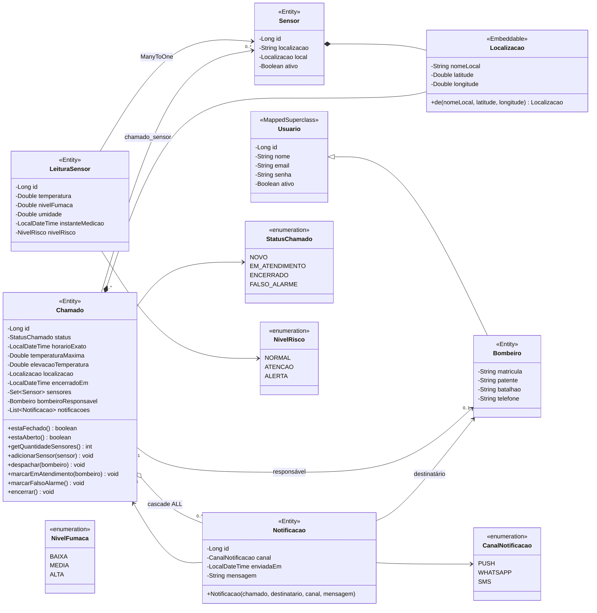
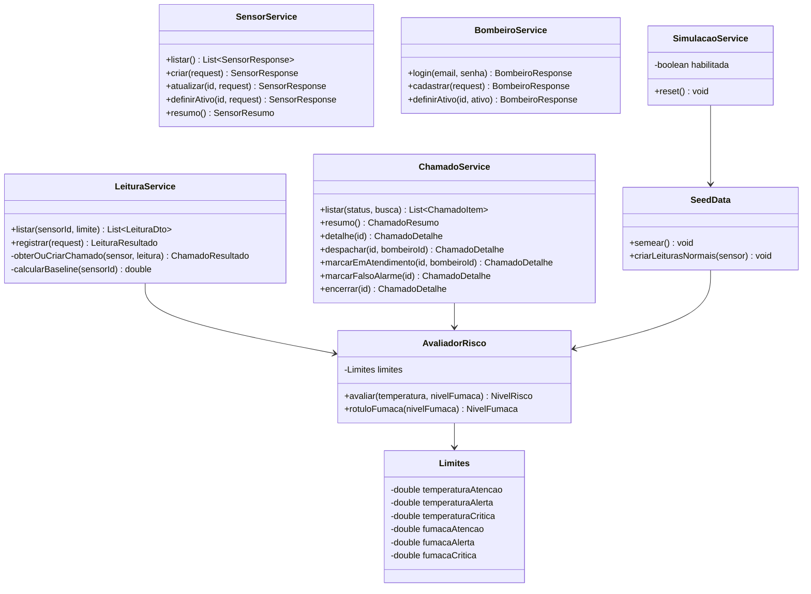

# Diagrama de classes

Diagrama Mermaid fiel ao código em `src/main/java/br/com/estacio/incendio`. DTOs e controllers são descritos na sequência para não sobrecarregar a visualização das entidades.

## Serviços e configuração

## API e DTOs

Controllers em `br.com.estacio.incendio.controller`:

- `BombeiroController` — `/api/bombeiros` (login, cadastro, consulta, atualização, ativação lógica).
- `SensorController` — `/api/sensores` (CRUD e resumo).
- `LeituraController` — `/api/leituras` (histórico e registro).
- `ChamadoController` — `/api/chamados` (lista, resumo, detalhe e quatro ações).
- `ConfiguracaoController` — `/api/configuracao/limites`.
- `SimulacaoController` — `/api/simulacao/reset`.
- `ApiExceptionHandler` — `@RestControllerAdvice` que produz `ErroResponse`.

DTOs principais: `LoginRequest`, `BombeiroRequest`, `BombeiroResponse`, `SensorRequest`, `SensorResponse`, `SensorResumo`, `AtivoRequest`, `LeituraRequest`, `LeituraDto`, `LeituraResultado`, `ChamadoItem`, `ChamadoResumo`, `ChamadoDetalhe`, `SensorDoChamado`, `NotificacaoDto`, `LimitesResponse` e `ErroResponse`.
